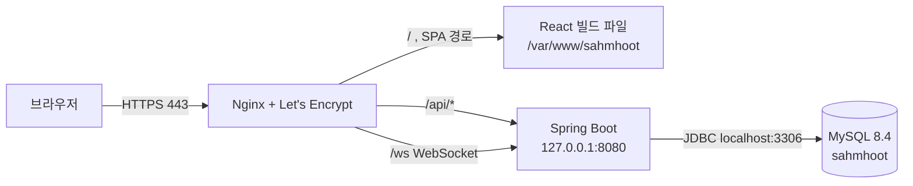

# 서버 구성·배포 절차

2026-11-15 기준 운영 서버(`https://sahmhoot.com`) 구성이다. 비밀값은 이 문서에 쓰지 않는다.

## 구조

GCP Compute Engine VM 한 대에 Nginx, Spring Boot, MySQL을 모두 둔다. 관리형 DB는 쓰지 않는다.



- HTTP(80)는 HTTPS로 301 리디렉션한다.
- 외부에 여는 포트는 80, 443, 22(SSH)다. 8080과 3306은 외부에서 닫혀 있다.
- Nginx가 `/api`, `/ws` 외의 경로는 모두 `index.html`로 돌려준다. 그래서 `/swagger-ui.html` 같은 경로도 200이지만 내용은 React 화면이다.

## 서버 사양

| 항목 | 값 |
|---|---|
| VM | `sahmhoot-server`, e2-medium (2 vCPU, 4GB) |
| 리전 | asia-northeast3 (서울) |
| 디스크 | 29GB |
| OS | Ubuntu 24.04 LTS |
| 외부 IP | 34.47.105.239 (고정) |

이슈 #18은 e2-small·e2-micro를 예정했지만 e2-medium으로 정했다. Java·MySQL·Nginx가 한 VM에서 돌고, #48에서 100명 동시 접속을 확인해야 하기 때문이다.

## 버전

| 구성 요소 | 버전 |
|---|---|
| Java | 21 (OpenJDK 21.0.13) |
| Spring Boot | 4.1.1 |
| MySQL | 8.4.13 LTS (MySQL 공식 APT 저장소 `mysql-8.4-lts`) |
| Nginx | 1.24.0 |
| Node.js | 24 (프론트 빌드용, NodeSource 저장소) |
| 인증서 | Let's Encrypt, Certbot(snap), `sahmhoot.com`·`www.sahmhoot.com` |

## 도메인

- 호스팅케이알에서 `sahmhoot.com`을 쓴다. 네임서버는 호스팅케이알 기본값이다.
- A 레코드 `@`, `www` → 34.47.105.239, TTL 60초.

## 서버 경로

| 경로 | 역할 |
|---|---|
| `~/sahmhoot/backend`, `~/sahmhoot/frontend` | Git 소스·빌드 작업 폴더 (관리자 계정 홈) |
| `/opt/sahmhoot/app.jar` | 실행 중인 백엔드 JAR |
| `/etc/sahmhoot.env` | 백엔드 환경변수. root만 읽게 둔다(`root:root`, 600) |
| `/etc/systemd/system/sahmhoot.service` | 백엔드 서비스 정의. `sahmhoot` 계정으로 `java -jar /opt/sahmhoot/app.jar` 실행 |
| `/var/www/sahmhoot/` | Nginx가 제공하는 프론트 빌드 파일 |
| `/etc/nginx/sites-available/sahmhoot` | 사이트 설정. `sites-enabled/sahmhoot`가 이 파일을 가리킨다 |
| `/etc/letsencrypt/` | 인증서. 개인키를 복사하거나 공유하지 않는다 |

소스를 바꿔도 서비스는 자동으로 바뀌지 않는다. 아래 재배포 절차를 따라야 한다.

## 환경변수 (`/etc/sahmhoot.env`)

값은 서버에만 둔다. 키 이름만 확인할 때는 `sudo grep -oE '^[A-Z_]+=' /etc/sahmhoot.env`를 쓴다.

| 키 | 상태 | 비고 |
|---|---|---|
| `DB_USERNAME`, `DB_PASSWORD` | 설정됨 | MySQL 앱 계정 `sahmhoot_app`@`localhost` |
| `JWT_SECRET` | 설정됨 | |
| `CORS_ALLOWED_ORIGINS` | 설정됨 | `https://sahmhoot.com,https://www.sahmhoot.com`. 없으면 브라우저 로그인·WebSocket이 403 |
| `SPRING_PROFILES_ACTIVE` | 설정됨 | `prod`. 없으면 `local`로 떠서 Swagger가 켜진다 |
| `APP_ROOM_JOIN_BASE_URL` | **미설정** | 기본값이 `http://localhost:5173`이라 참여 링크·QR이 localhost를 가리킨다. `https://sahmhoot.com`으로 설정해야 한다 |
| `MAIL_HOST`, `MAIL_USERNAME`, `MAIL_PASSWORD`, `MAIL_FROM` | 미설정 | #21에서 설정. 비어 있으면 인증 코드가 메일 대신 서버 로그에 찍힌다 |
| `ALLOWED_EMAIL_DOMAINS` | 미설정 | 가입 허용 도메인. 운영 전에 정한다 |

`DB_URL`은 기본값(`localhost:3306/sahmhoot`)을 쓴다. 환경변수를 바꾼 뒤에는 `sudo systemctl restart sahmhoot`로 다시 읽게 한다.

## 재배포

명령은 서버에 SSH로 접속해서 실행한다. 재시작하는 동안 수 초간 API가 끊긴다.

### 백엔드

실행 중인 JAR를 덮어쓰면 종료 중인 프로세스가 `NoClassDefFoundError`를 낼 수 있다. 서비스를 먼저 멈춘다.

```bash
cd ~/sahmhoot/backend
git pull
./gradlew clean bootJar
sudo cp /opt/sahmhoot/app.jar /opt/sahmhoot/app.jar.bak   # 되돌릴 때 사용
sudo systemctl stop sahmhoot
sudo cp build/libs/sahmhoot-0.0.1-SNAPSHOT.jar /opt/sahmhoot/app.jar
sudo systemctl start sahmhoot
sudo journalctl -u sahmhoot -n 50 --no-pager   # Started SahmhootApplication 확인
curl -s https://sahmhoot.com/api/health        # {"status":"UP"}
```

Flyway 마이그레이션은 기동할 때 자동으로 적용된다. 새 마이그레이션이 있으면 먼저 DB를 덤프한다.

### 프론트엔드

```bash
cd ~/sahmhoot/frontend
git pull
npm ci
npm run build
sudo cp -a dist/. /var/www/sahmhoot/
```

Nginx 재시작은 필요 없다.

## 백업

```bash
sudo mysqldump --single-transaction --routines --triggers --databases sahmhoot > ~/sahmhoot-backup-$(date +%F).sql
chmod 600 ~/sahmhoot-backup-*.sql
```

VM 한 대에 DB가 같이 있으므로, 큰 작업 전에는 GCP 콘솔에서 디스크 스냅샷도 만든다.

## 인증서

- Certbot snap이 설치한 `snap.certbot.renew.timer`가 하루 두 번 갱신 여부를 확인한다.
- 갱신 점검: `sudo certbot renew --dry-run`
- 만료일 확인: `sudo certbot certificates`

## 점검 명령

```bash
sudo systemctl is-active sahmhoot mysql nginx
sudo nginx -t
curl -I https://sahmhoot.com
curl -s https://sahmhoot.com/api/health
```

WebSocket은 Origin을 실제 도메인으로 붙여 확인한다. 101이면 정상, 403이면 `CORS_ALLOWED_ORIGINS`를 확인한다.

```bash
curl -s -o /dev/null -w "%{http_code}\n" --http1.1 \
  -H "Connection: Upgrade" -H "Upgrade: websocket" \
  -H "Sec-WebSocket-Version: 13" -H "Sec-WebSocket-Key: dGhlIHNhbXBsZSBub25jZQ==" \
  -H "Origin: https://sahmhoot.com" https://sahmhoot.com/ws --max-time 3
```
