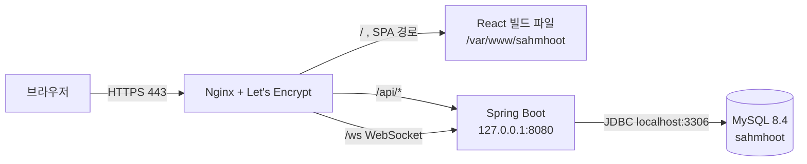

# 서버 구성·배포 절차

2026-11-15 기준 운영 서버(`https://sahmhoot.com`) 구성이다. 비밀값은 이 문서에 쓰지 않는다.

## 구조

GCP Compute Engine VM 한 대에 Nginx, Spring Boot, MySQL을 모두 둔다. 관리형 DB는 쓰지 않는다.



- HTTP(80)는 HTTPS로 301 리디렉션한다.
- 외부에 여는 포트는 80, 443, 22(SSH)다. 8080과 3306은 외부에서 닫혀 있다.
- Nginx가 `/api`, `/ws` 외의 경로는 모두 `index.html`로 돌려준다. 그래서 `/swagger-ui.html` 같은 경로도 200이지만 내용은 React 화면이다.

## 서버 사양

| 항목 | 값 |
|---|---|
| VM | `sahmhoot-server`, e2-medium (2 vCPU, 4GB) |
| 리전 | asia-northeast3 (서울) |
| 디스크 | 29GB |
| OS | Ubuntu 24.04 LTS |
| 외부 IP | 34.47.105.239 (고정) |

이슈 #18은 e2-small·e2-micro를 예정했지만 e2-medium으로 정했다. Java·MySQL·Nginx가 한 VM에서 돌고, #48에서 100명 동시 접속을 확인해야 하기 때문이다.

## 버전

| 구성 요소 | 버전 |
|---|---|
| Java | 21 (OpenJDK 21.0.13) |
| Spring Boot | 4.1.1 |
| MySQL | 8.4.13 LTS (MySQL 공식 APT 저장소 `mysql-8.4-lts`) |
| Nginx | 1.24.0 |
| Node.js | 24 (프론트 빌드용, NodeSource 저장소) |
| 인증서 | Let's Encrypt, Certbot(snap), `sahmhoot.com`·`www.sahmhoot.com` |

## 도메인

- 호스팅케이알에서 `sahmhoot.com`을 쓴다. 네임서버는 호스팅케이알 기본값이다.
- A 레코드 `@`, `www` → 34.47.105.239, TTL 60초.

## 서버 경로

| 경로 | 역할 |
|---|---|
| `~/sahmhoot/backend`, `~/sahmhoot/frontend` | Git 소스·빌드 작업 폴더 (관리자 계정 홈). 배포 스크립트가 배포한 커밋에 고정한다 |
| `~/sahmhoot/deploy-last.log` | 마지막 배포의 실행 로그(빌드 출력, 실패 시 서비스 로그). 주인만 읽기(600) |
| `/opt/sahmhoot/app.jar` | 실행 중인 백엔드 JAR. 직전 버전은 `app.jar.bak` |
| `/etc/sahmhoot.env` | 백엔드 환경변수. root만 읽게 둔다(`root:root`, 600). 키 목록은 레포 `deploy/sahmhoot.env.example` |
| `/etc/systemd/system/sahmhoot.service` | 백엔드 서비스 정의. `sahmhoot` 계정으로 `java -jar /opt/sahmhoot/app.jar` 실행. MySQL이 먼저 떠야 시작한다(`Requires=mysql.service`). 레포 사본 `deploy/systemd/sahmhoot.service`(2026-11-18 서버 파일과 같음) |
| `/var/www/sahmhoot/` | Nginx가 제공하는 프론트 빌드 파일 |
| `/etc/nginx/sites-available/sahmhoot` | 사이트 설정. `sites-enabled/sahmhoot`가 이 파일을 가리킨다. 레포 사본 `deploy/nginx/sahmhoot.conf` |
| `/etc/letsencrypt/` | 인증서. 개인키를 복사하거나 공유하지 않는다 |
| `/var/backups/sahmhoot/` | 배포 직전 DB 백업(`predeploy-*.sql.gz`). root만 읽기, 14일 보관 |
| `/var/log/sahmhoot-deploy.log` | 배포 기록(시각, 브랜치, 커밋, 실행한 계정) |

소스를 바꿔도 서비스는 자동으로 바뀌지 않는다. 아래 재배포 절차를 따라야 한다.

## Nginx 설정

`/etc/nginx/sites-available/sahmhoot` 전문은 레포 [`deploy/nginx/sahmhoot.conf`](deploy/nginx/sahmhoot.conf)에 있다. `# managed by Certbot` 줄은 `certbot --nginx`가 HTTPS를 붙이면서 추가했다. 서버 파일을 바꾸면 레포 사본도 같은 PR에서 고친다.

| 부분 | 역할 |
|---|---|
| `location /` + `try_files ... /index.html` | 파일이 없으면 `index.html`을 준다. React Router 경로를 새로고침해도 404가 나지 않는다 |
| `location /api/` | `/api/*` 요청을 Spring Boot(8080)로 넘긴다. `X-Forwarded-*`로 원래 클라이언트 IP와 https 여부를 전달한다 |
| `location /ws` | WebSocket 업그레이드(`Upgrade`, `Connection` 헤더, HTTP/1.1)를 Spring Boot로 넘긴다. `proxy_read_timeout 3600s`는 수업 중 연결이 60초 기본값에 끊기지 않게 한다 |
| 443 `server` | 인증서 경로와 TLS 설정. 개인키(`privkey.pem`)는 경로만 적혀 있고 내용은 서버 밖으로 꺼내지 않는다 |
| 80 `server` | 두 도메인의 HTTP 요청을 HTTPS로 301 리디렉션한다. 그 외 Host는 404 |

설정을 바꾼 뒤에는 `sudo nginx -t`로 문법을 확인하고 `sudo systemctl reload nginx`로 반영한다.

## 환경변수 (`/etc/sahmhoot.env`)

값은 서버에만 둔다. 키 이름만 확인할 때는 `sudo grep -oE '^[A-Z_]+=' /etc/sahmhoot.env`를 쓴다. 키 목록과 설명은 레포 [`deploy/sahmhoot.env.example`](deploy/sahmhoot.env.example)에 있다.

필수 키(`DB_USERNAME`, `DB_PASSWORD`, `JWT_SECRET`, `CORS_ALLOWED_ORIGINS`, `APP_ROOM_JOIN_BASE_URL`, `MAIL_FROM`, `SPRING_PROFILES_ACTIVE=prod`)가 하나라도 없으면 배포 스크립트가 멈춘다. systemd가 실제로 쓰는 값으로 확인하므로 `""`·`''`·공백만인 값과, 같은 키를 두 번 적은 경우(뒤의 값이 쓰인다)도 멈춘다. 키는 한 줄에 하나만 둔다. `application-prod.yml`은 DB 계정·`CORS_ALLOWED_ORIGINS`·`APP_ROOM_JOIN_BASE_URL`의 로컬 기본값을 쓰지 않으므로, 스크립트 없이 재시작해도 이 넷이 없으면 기동하지 않는다. `MAIL_FROM`도 prod에서 비어 있으면 앱이 기동을 멈춘다(#21 `ProductionAuthSettingsValidator`).

| 키 | 상태 | 비고 |
|---|---|---|
| `DB_USERNAME`, `DB_PASSWORD` | 설정됨 | MySQL 앱 계정 `sahmhoot_app`@`localhost`. 필수 |
| `JWT_SECRET` | 설정됨 | 필수 |
| `CORS_ALLOWED_ORIGINS` | 설정됨 | `https://sahmhoot.com,https://www.sahmhoot.com`. 필수. 없으면 브라우저 로그인·WebSocket이 403 |
| `SPRING_PROFILES_ACTIVE` | 설정됨 | `prod`여야 한다. 없으면 `local`로 떠서 Swagger가 켜진다 |
| `APP_ROOM_JOIN_BASE_URL` | 설정됨 (2026-11-18 확인) | 필수. `https://sahmhoot.com`. 없으면 참여 링크·QR이 localhost를 가리킨다 |
| `MAIL_FROM` | **미설정** (2026-11-18 확인) | 필수(#21). 인증 메일 보내는 주소. 넣기 전에는 배포 스크립트가 멈춘다 |
| `MAIL_HOST` | 미설정 | 선택. 비우면 같은 VM의 Postfix(`127.0.0.1:25`)로 보낸다. Postfix 설정은 #21 |
| `ALLOWED_EMAIL_DOMAINS` | 미설정 | 가입 허용 도메인. 운영 전에 정한다 |

`DB_URL`은 기본값(`localhost:3306/sahmhoot`)을 쓴다. 환경변수를 바꾼 뒤에는 `sudo systemctl restart sahmhoot`로 다시 읽게 한다.

## 재배포

레포의 [`deploy/deploy.sh`](deploy/deploy.sh)로 한 번에 한다. **배포는 담당자 한 명이 소스 폴더(`~/sahmhoot/backend`, `~/sahmhoot/frontend`)의 주인인 관리자 계정으로만 한다.** 다른 계정에는 소스 폴더가 없어 스크립트가 돌지 않는다. 주인 계정은 서버에서 `stat -c %U ~<계정>/sahmhoot/backend`로 확인한다. 재시작하는 동안 API·WebSocket이 잠시 끊기므로 **수업 중에는 배포하지 않는다.**

```bash
# 내 PC에서 (계정은 서버 관리자 계정)
ssh <계정>@sahmhoot.com 'bash ~/sahmhoot/backend/deploy/deploy.sh all develop'

# 서버에 접속해 있다면
bash ~/sahmhoot/backend/deploy/deploy.sh all develop

# 접속이 끊겼다면 다시 접속해 이어서 본다
tail -f ~/sahmhoot/deploy-last.log
```

- 접속이 끊겨도 스크립트는 끝까지 실행된다. 화면에는 안내 줄만 나오고, 빌드 출력과 실패 시 서비스 로그는 `~/sahmhoot/deploy-last.log`에 남는다.

- 대상: `all`(백엔드 → 프론트 순서), `backend`, `frontend`. 브랜치나 태그를 생략하면 `develop`이다. 같은 이름을 두 저장소에 함께 쓰므로, 백엔드에만 있는 브랜치는 `backend <브랜치>`와 `frontend develop`으로 나눠 실행한다. 최종 배포(#33)는 `deploy.sh all v1.0.0`처럼 태그로 한다.
- 스크립트가 하는 일: 비밀번호 없는 sudo·프론트 배포 폴더·필수 환경변수 확인 → 소스를 원격 브랜치·태그의 커밋에 맞춤 → 백엔드·프론트 빌드 → DB 백업(`/var/backups/sahmhoot`) → 지금 JAR를 `app.jar.bak`으로 보관 → 새 JAR를 `app.jar.new`로 준비한 뒤 멈춤·교체·시작 → `/api/health`가 90초 안에 UP인지 확인 → 프론트 복사 → `/var/log/sahmhoot-deploy.log`에 기록. 빌드가 모두 끝난 뒤에만 서비스를 바꾸므로, 빌드가 실패하면 운영 중인 서버는 그대로다.
- 교체·시작이 실패하거나 새 버전이 UP이 되지 않으면 `app.jar.bak`(직전 버전)으로 되돌리고 실패로 끝난다. 새 JAR 준비(복사)나 DB 백업이 실패하면 서비스를 멈추기 전에 끝난다. DB는 되돌리지 않는다. Flyway 마이그레이션은 기동할 때 적용되므로, 필요하면 백업 파일로 복원한다(아래 "백업").
- 멈추는 경우: sudo가 비밀번호를 요구할 때, 필수 키가 없거나 비었거나 중복일 때, 서버 소스 폴더에 커밋하지 않은 변경이 있을 때, 브랜치·태그가 없을 때, 다른 배포가 진행 중일 때.
- 소스 폴더는 배포한 커밋에 고정(detached HEAD)된다. 서버에서 `git pull`이나 파일 수정을 하지 않는다. 고칠 것은 PR로 올린다.
- 프론트는 이전 빌드 파일을 지우지 않는다. 이미 열려 있는 화면이 예전 파일을 계속 불러올 수 있게 하기 위해서다.
- 스크립트를 고쳤다면 PR 전에 `bash deploy/test-deploy.sh`로 가짜 서버 시험을 돌린다. 이 스크립트는 서버에서 sudo로 실행되므로 `deploy/` 변경은 리뷰를 받고 머지한다.

### 처음 한 번 (스크립트 도입 전 서버)

스크립트가 develop에 머지된 뒤 한 번만 한다. 2026-11-18 기준 서버는 11/12에 수동으로 올린 JAR로 돌고 있고 DB에는 V1만 있다. 첫 실행 때 채팅 테이블(V2)이 처음 적용된다.

1. GCP 콘솔에서 디스크 스냅샷을 만든다. DB 백업과 `app.jar.bak`은 스크립트가 교체 전에 직접 만든다.
2. 소스 폴더(`~/sahmhoot/backend`, `~/sahmhoot/frontend`)의 주인인 관리자 계정으로 접속한다. 스크립트는 자기 위치 기준으로 옆의 `frontend`를 찾는다.
3. 두 소스 폴더에 커밋하지 않은 변경이 없는지 확인한다(`git -C ~/sahmhoot/backend status`, 프론트도 같이). `git status --ignored`로 `application-local.yml` 같은 파일이 남아 있지 않은지도 본다.
4. `/etc/sahmhoot.env`에 `MAIL_FROM`(#21)을 넣는다. 키 이름만 `sudo grep -oE '^[A-Z_]+=' /etc/sahmhoot.env`로 [`deploy/sahmhoot.env.example`](deploy/sahmhoot.env.example)의 필수 키와 비교한다.
5. 백엔드 소스를 스크립트가 있는 커밋으로 한 번 맞춘 뒤 실행한다.

   ```bash
   git -C ~/sahmhoot/backend fetch origin
   git -C ~/sahmhoot/backend checkout --detach origin/develop
   bash ~/sahmhoot/backend/deploy/deploy.sh all develop
   ```

### 직접 되돌리기

스크립트가 되돌리지 못했거나 배포 뒤에 문제를 발견했을 때 쓴다.

```bash
sudo systemctl stop sahmhoot
sudo cp -p /opt/sahmhoot/app.jar.bak /opt/sahmhoot/app.jar
sudo systemctl start sahmhoot
sudo journalctl -u sahmhoot -n 50 --no-pager   # Started SahmhootApplication 확인
curl -s https://sahmhoot.com/api/health        # {"status":"UP"}
```

## 백업

```bash
sudo mysqldump --single-transaction --routines --triggers --databases sahmhoot > ~/sahmhoot-backup-$(date +%F).sql
chmod 600 ~/sahmhoot-backup-*.sql
```

VM 한 대에 DB가 같이 있으므로, 큰 작업 전에는 GCP 콘솔에서 디스크 스냅샷도 만든다.

배포 스크립트는 백엔드를 교체하기 전에 `/var/backups/sahmhoot/predeploy-날짜-시각-번호.sql.gz`를 만들고 14일 지난 것은 지운다. 정기 자동 백업은 아직 없다(#98). 복원은 아래 순서로 한다. 현재 DB를 덮어쓰므로 먼저 지금 상태를 한 번 더 덤프한다. 복원하는 동안 앱이 DB에 쓰거나 마이그레이션을 다시 돌리지 않게 서비스를 먼저 멈추고, 백업 시점의 JAR(보통 `app.jar.bak`)로 다시 시작한다. 백업에 없는 테이블(새 마이그레이션이 만든 테이블)은 지워지지 않으므로, 그 마이그레이션을 다시 적용하려면 해당 테이블을 먼저 지운다.

```bash
sudo systemctl stop sahmhoot
gunzip -c /var/backups/sahmhoot/predeploy-날짜-시각-번호.sql.gz | sudo mysql
sudo cp -p /opt/sahmhoot/app.jar.bak /opt/sahmhoot/app.jar   # 백업 시점 버전으로
sudo systemctl start sahmhoot
curl -s https://sahmhoot.com/api/health
```

## 레포·이슈·PR에 올리지 않는 것

세 레포 모두 공개 저장소다. 한 번 올라간 값은 지워도 git 기록에 남으므로, 실수로 올렸다면 지우는 것으로 끝내지 말고 그 값을 바꾼다.

| 올리지 않는 것 | 두는 곳 |
|---|---|
| 환경변수 값(DB 비밀번호, `JWT_SECRET`, 메일 앱 비밀번호) | 서버 `/etc/sahmhoot.env`, 노션 비공개 페이지 |
| 메일 계정 비밀번호·앱 비밀번호 | 노션 비공개 페이지 |
| SSH 개인키(`.pub`이 아닌 키 파일), GCP 인증 키(`.json`) | 각자 PC |
| 인증서 개인키 `privkey.pem` | 서버 `/etc/letsencrypt/` |
| DB 백업 파일(회원 이메일·비밀번호 해시 포함) | 서버 `/var/backups/sahmhoot/` |
| 서버 로그(사용자 이메일, 메일 설정 전에는 인증 코드 포함) | 서버 `journalctl` |
| `application-local.yml` | 각자 PC (gitignore 대상) |

키 이름(`JWT_SECRET=`)과 파일 경로는 올려도 된다. 캡처 이미지에 값이 보이지 않는지도 확인한다.

## 인증서

- Certbot snap이 설치한 `snap.certbot.renew.timer`가 하루 두 번 갱신 여부를 확인한다.
- 갱신 점검: `sudo certbot renew --dry-run`
- 만료일 확인: `sudo certbot certificates`

## 점검 명령

```bash
sudo systemctl is-active sahmhoot mysql nginx
sudo nginx -t
curl -I https://sahmhoot.com
curl -s https://sahmhoot.com/api/health
```

WebSocket은 Origin을 실제 도메인으로 붙여 확인한다. 101이면 정상, 403이면 `CORS_ALLOWED_ORIGINS`를 확인한다.

```bash
curl -s -o /dev/null -w "%{http_code}\n" --http1.1 \
  -H "Connection: Upgrade" -H "Upgrade: websocket" \
  -H "Sec-WebSocket-Version: 13" -H "Sec-WebSocket-Key: dGhlIHNhbXBsZSBub25jZQ==" \
  -H "Origin: https://sahmhoot.com" https://sahmhoot.com/ws --max-time 3
```
